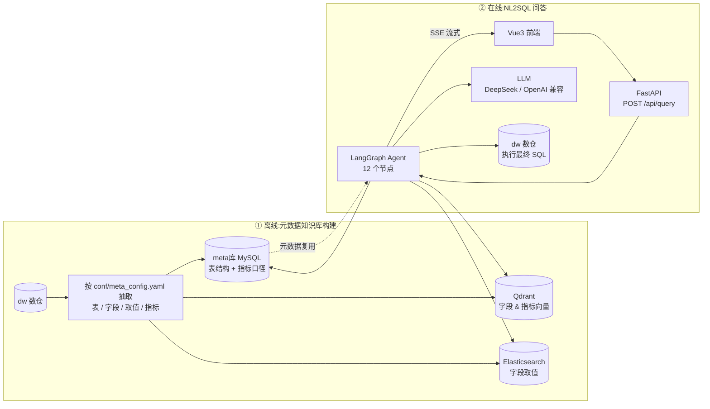
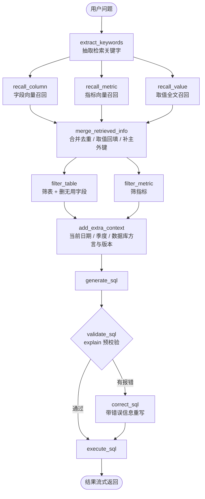

# SQL-Agent — 基于 LangGraph 的 NL2SQL 智能问数系统

用自然语言直接问数据库:输入「统计华北地区销售总额」,系统自动完成**字段/指标/取值三路召回 → 表与字段筛选 → SQL 生成 → 校验纠错 → 执行**,并把每一步进度和最终结果以 SSE 流式推给前端。

与「一句 prompt 让大模型硬写 SQL」的做法不同,这里的模型只负责**选择**和**生成**,真正喂给它的表结构是先从元数据知识库里检索出来的,所以列名、枚举值、指标口径都不会瞎编。

---

## 效果与特性

- **三路并行召回**:字段(向量)、指标(向量)、字段取值(全文检索)同时进行,LangGraph 自动并发
- **主外键自动补全**:召回命中字段后,自动把同表的主键/外键补进上下文,避免生成 `JOIN` 缺失
- **枚举值回填**:ES 召回到的取值(如「华北」)写回该字段的 `examples`,让模型知道该列长什么样
- **两步筛选**:先让 LLM 从候选表/指标里挑出真正相关的,再精简字段,显著压缩 prompt 长度
- **SQL 自愈**:`explain` 预校验失败时带着数据库原始报错让模型改一次,再执行
- **全链路可观测**:每个节点通过 `stream_writer` 推送 `progress` 事件,前端实时显示执行到哪一步

---

## 整体架构

系统分两条链路:离线把数仓的元数据灌进知识库,在线用知识库做检索增强的 SQL 生成。



### 问答主链路(12 个节点)



> 三个 `recall_*` 节点是**并行**的(`extract_keywords` 各连一条边),`filter_table` 与 `filter_metric` 同理,由 LangGraph 的 superstep 机制自动并发。

---

## 技术栈

| 层 | 选型 |
| --- | --- |
| Agent 编排 | LangGraph 1.x(StateGraph + 条件边 + Runtime Context) |
| 模型调用 | LangChain、`ChatOpenAI` 对接 DeepSeek(OpenAI 兼容协议) |
| 向量检索 | Qdrant(collections: `data-agent-column`、`data-agent-metric`) |
| 全文检索 | Elasticsearch(字段取值) |
| 元数据 / 数仓 | MySQL,SQLAlchemy 2.x + asyncmy 异步驱动 |
| Embedding | HuggingFace TEI 服务(`BAAI/bge-large-zh-v1.5`,1024 维) |
| Web 服务 | FastAPI + SSE 流式响应 |
| 前端 | Vue 3 + Vite(流式对话界面,支持进度条 / 结果表格) |

---

## 目录结构

```
PythonProject/
├── main.py                          # FastAPI 入口:装配路由 + 请求耗时中间件
├── requirements.txt
├── conf/
│   ├── app_config.yaml              # 本地配置(含密码,已 gitignore)
│   ├── app_config.example.yaml      # 配置模板
│   └── meta_config.yaml             # 需要同步进知识库的表 / 字段 / 指标定义
└── app/
    ├── agent/
    │   ├── graph.py                 # 图编排:节点注册 + 边 + 条件边 + 本地调试入口
    │   ├── state.py                 # DataAgentState(全局状态)
    │   ├── context.py               # DataAgentContext(依赖注入:仓储 / Embedding)
    │   ├── llm.py                   # LLM 实例(Key 读配置)
    │   └── nodes/                   # 12 个节点,一个文件一个节点
    ├── api/
    │   ├── dependencies.py          # FastAPI 依赖注入 + 全局单例
    │   ├── routers/query_router.py  # POST /api/query(SSE)
    │   └── schemas/query_schema.py
    ├── services/
    │   ├── query_service.py         # 在线问答:跑图 + 把 chunk 转 SSE
    │   └── meta_knowledge_service.py# 离线构建:写 meta 库 / Qdrant / ES
    ├── repositories/                # 持久层:mysql(dw/meta)、qdrant、es
    ├── clients/                     # 各中间件客户端管理器(init / close)
    ├── entities/ models/            # 领域实体 / ORM 模型
    ├── prompt/                      # .prompt 模板加载器
    ├── prompts/                     # 7 个提示词模板
    ├── scripts/build_meta_knowledge.py  # 知识库构建脚本入口
    ├── conf/                        # 配置 dataclass + OmegaConf 加载
    └── core/                        # 日志、lifespan、请求上下文
data-agent-fronted/                  # Vue3 + Vite 前端
```

---

## 快速开始

### 1. 准备依赖服务

| 服务 | 用途 | 默认地址 |
| --- | --- | --- |
| MySQL | `meta` 库存元数据/指标,`dw` 库存业务数据 | `your-mysql-host:3306` |
| Qdrant | 字段、指标向量库 | `your-qdrant-host:6333` |
| Elasticsearch | 字段取值全文索引 | `your-es-host:9200` |
| TEI Embedding | 文本向量化服务 | `127.0.0.1:8081` |

Embedding 服务可用官方镜像起一个:

```bash
docker run -d --name tei -p 8081:80 \
  ghcr.io/huggingface/text-embeddings-inference:latest \
  --model-id BAAI/bge-large-zh-v1.5
```

### 2. 配置

```bash
cp conf/app_config.example.yaml conf/app_config.yaml
# 按实际环境填写 db_meta / db_dw / qdrant / es / embedding / llm
```

`conf/app_config.yaml` 已被 `.gitignore` 忽略,密码和 API Key 不会被提交。
`llm.api_key` 必填,也可以改用环境变量 `DEEPSEEK_API_KEY` 兜底。

### 3. 安装依赖

```bash
python -m venv venv
venv\Scripts\activate           # Windows;macOS/Linux: source venv/bin/activate
pip install -r requirements.txt --no-cache-dir
```

### 4. 构建元数据知识库(只需在表结构变化时重跑)

```bash
python -m app.scripts.build_meta_knowledge
# 或指定配置文件
python -m app.scripts.build_meta_knowledge -c conf/meta_config.yaml
```

脚本会按 `conf/meta_config.yaml` 读取数仓表结构,写入 meta 库、Qdrant 两个 collection 和 ES 索引。

### 5. 启动后端

```bash
uvicorn main:app --host 0.0.0.0 --port 8000 --reload
```

启动时会通过 lifespan 统一初始化 Embedding / Qdrant / ES / MySQL 客户端,关闭时释放连接。

### 6. 启动前端

```bash
cd data-agent-fronted
npm install
npm run dev          # Vite 默认 5173,/api 已代理到 http://localhost:8000
```

---

## 接口约定

### `POST /api/query`

请求体:

```json
{ "query": "统计各分类销售商品数量" }
```

响应为 `text/event-stream`,每条事件的 `data` 是一个 JSON:

```text
data: {"type": "progress", "step": "召回字段", "status": "running"}
data: {"type": "progress", "step": "召回字段", "status": "success"}
data: {"type": "progress", "step": "生成sql", "status": "success"}
data: {"type": "result", "data": [{"category": "手机", "cnt": 12}]}
```

| 字段 | 说明 |
| --- | --- |
| `type=progress` | 节点级进度,`status` 取 `running` / `success` / `error` |
| `type=result` | 最终查询结果,`data` 为行字典列表 |

另有一个连通性测试接口 `GET /hello/{address}?name=xx`。

---

## 设计要点

**为什么用两套数据库?** `meta` 库只存元数据(表、字段、指标口径、别名),`dw` 库存真实业务数据。问答时检索走 meta,执行 SQL 走 dw,元数据可以独立重建而不动业务库。

**为什么取值要单独走 ES?** 「华北」这类字符串在字段向量里表达不出来,而全文检索能精确命中枚举值;命中后回填到字段的 `examples`,模型才知道 `region_name` 里存的是「华北」而不是「North China」。

**为什么要补主外键?** 召回通常只命中筛选字段,但生成 SQL 还需要 JOIN 键。`merge_retrieved_info` 按 `table_id` 归并后查一次主外键补齐,比事后让模型猜列名可靠得多。

**校验为什么用 `explain`?** 不真实执行就能让数据库解析 SQL,列名拼错、表不存在会立刻报错,把数据库的原始错误信息交给 `correct_sql`,比让模型自查有效。

---

## 已知限制

- `execute_sql` 未做行数上限,大结果集会一次性载入内存,生产环境建议加 `LIMIT` 或分页。
- 单轮问答,暂不支持多轮上下文追问。
- 元数据知识库为全量重建,尚未实现增量同步。
- 前端未做移动端适配与结果分页。

---

## 说明

本项目为个人学习实践项目,用于验证「检索增强 + 图编排」在 NL2SQL 场景下的落地方式。
实现思路可自由参考,如果对你有帮助,欢迎点个 Star。
